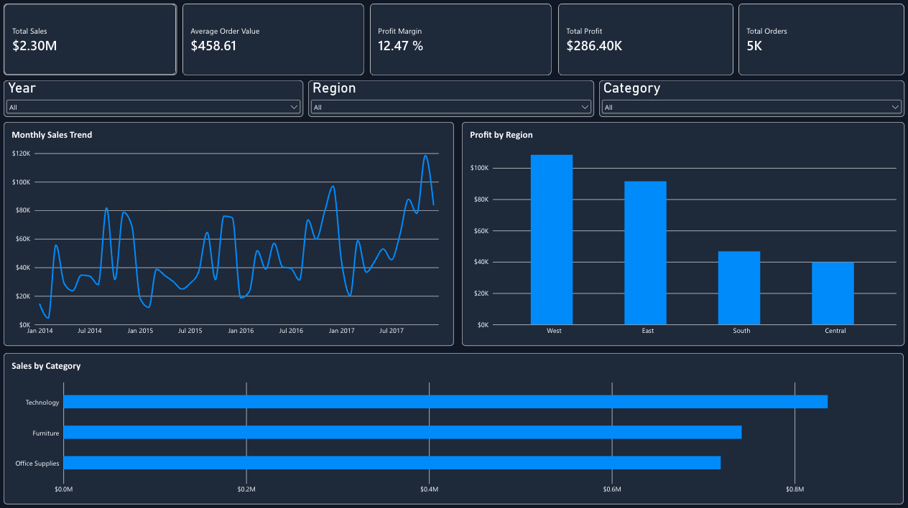

# Superstore Sales Performance Dashboard

## Project Overview

This project analyzes retail sales performance using Microsoft Power BI. I created an interactive dashboard to track sales, profit, orders, and business performance across different regions and product categories.

The goal was to transform raw sales data into clear, useful business insights.

## Dashboard Preview

## Tools Used

- Microsoft Power BI
- Power Query
- DAX (Data Analysis Expressions)
- CSV dataset
- GitHub

## Dataset

The project uses the Sample Superstore dataset, containing 9,994 sales records from 2014 through 2017.

The dataset includes order dates, sales, profit, product categories, customer information, and geographic regions.

## Data Preparation

I used Power Query to prepare the dataset before building the dashboard.

- Imported the CSV dataset.
- Reviewed the data structure and column types.
- Converted date, currency-related, and numeric fields into appropriate data types.
- Checked for duplicate records.
- Prepared the data for analysis.

## DAX Measures

I created five DAX measures to calculate key business metrics:

- Total Sales
- Total Profit
- Total Orders
- Profit Margin
- Average Order Value

These measures automatically update when dashboard filters are applied.

See [DAX Measures](dax/measures.md) for the calculations.

## Dashboard Features

The dashboard includes:

- Five KPI cards displaying important business metrics.
- Monthly Sales Trend line chart.
- Sales by Category horizontal bar chart.
- Profit by Region column chart.
- Interactive Year, Region, and Category slicers.
- A consistent dark-themed dashboard design.

## Key Findings

Based on the full dataset:

- **Total Sales:** Approximately $2.30 million.
- **Total Profit:** Approximately $286,400.
- **Profit Margin:** 12.47%.
- **Total Orders:** Approximately 5,000.
- **Average Order Value:** $458.61.
- **Technology** generated the highest sales among the three categories.
- **West** generated the highest profit among the four regions.

## Project Workflow

1. Data Import
2. Data Cleaning
3. Data Modeling
4. DAX Calculations
5. Dashboard Development
6. Dashboard Formatting
7. Interactive Slicers
8. Final Testing and Presentation

## Project Demonstration

Development recordings and a final dashboard walkthrough document the process of building and testing the report.

## Conclusion

This project demonstrates my ability to clean and prepare data, create DAX measures, build visualizations, and develop interactive Power BI dashboards to support business analysis.
